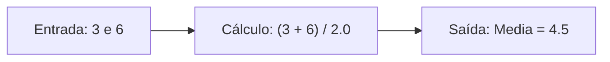

# ☕ 02 · Introdução sobre Programação, Algoritmos e a JVM

> **Curso:** Curso Java primeiros passos: Lógica de Programação e Algoritmos (Prof. Dr. Nelio Alves)  
> **Capítulo:** Introdução sobre programação (Material de apoio: `02-introducao.pdf`)  
> **Autora:** Sra. Oliveira  
> **Padrão:** Anotações originais preservadas na íntegra + dados dos slides e complementações do Javi (`> 🌻 Complemento do Javi:`).

---

## Observação Inicial sobre a Numeração dos Capítulos

> 🌻 **Complemento do Javi (Alinhamento da Trilha):**
> O **Capítulo 1** do curso na Udemy foi apenas uma apresentação do professor Nelio Alves (um vídeo introdutório de 17 minutos mostrando a ementa, a metodologia prática e o mapa da carreira Java profissional — fundamentos vs. mercado comercial). 
> O estudo e a teoria técnica começaram de fato aqui no **Capítulo 2**, que acompanha o arquivo `02-introducao.pdf`.

---

## 1. Algoritmo, Automação e Programa de Computador

### Suas Anotações:
- Clássico, a explicação do que é
  - ↳ Sequência finita de passos para uma solução
- Automação: uso de máquinas para o procedimento desejado, podendo ser automático ou semiautomático
- Nunca tinha pensado que a máquina de lavar é uma "automação"

**Programa ~ Algoritmo**
- Programas de computador são algoritmos executados pelo computador (em linhas gerais)
- **[Dúvida]** ?? como assim
- O computador é uma máquina que automatiza a execução de algoritmos
- Mas não todos, apenas algoritmos computacionais. Como processamento de dados e cálculos
- [Comentário: Gostei]

### Dados dos Slides (Exemplo do PDF):
*Problema do cotidiano:* Lavar roupa suja  
*Algoritmo manual:*
1. Colocar a roupa em um recipiente
2. Colocar sabão e amaciante
3. Encher de água
4. Mexer tudo até dissolver o sabão
5. Deixar de molho por 20 minutos
6. Esfregar a roupa
7. Enxaguar
8. Torcer

*Automação:* A máquina de lavar executa os passos de 3 a 8 de forma autônoma. O computador faz exatamente o mesmo princípio, mas automatizando **cálculos matemáticos** e **processamento de informações**.

> 🌻 **Complemento do Javi:**
> 
> **"Como assim programa é algoritmo?"**
> Pense que um computador, por dentro, é uma máquina burra com uma velocidade inacreditável. Ele não tem intuição nem bom senso; ele só sabe somar zeros e uns e mover dados na memória física.
> 
> Um **algoritmo** é a lógica pura na sua mente (o passo a passo abstrato para calcular um desconto ou achar o menor caminho no mapa). O **programa** é essa lógica traduzida em um arquivo de texto que o computador consegue seguir cegamente, sem errar um milímetro. Você é a arquiteta do raciocínio; o computador é o operário hiperveloz que executa o procedimento.

---

## 2. O que é preciso para fazer um programa de computador?

### Suas Anotações:
- Uma linguagem de programação com regras **(léxicas e sintáticas)** *(circulado em vermelho)*
  - **[Dúvida]** Como assim? Para escrever o programa Javinha ♥
- Uma IDE (VSCode, Eclipse, IntelliJ) para editar o código e testar
- Compilador para transformar nosso código escrito (código fonte) para código objeto
- Gerador de código ou máquina virtual -> software que permite que o programa seja executado

### Suas Anotações sobre Léxica e Sintática:
- Linguagem de programação -> possui regras léxicas (ortografia) e sintáticas (gramática) para se escrever programas
- **Léxica:** refere-se à correção de palavras sozinhas, "isoladas"
  - ↳ `maim` (errado) · `main` (certo)
- **Sintática:** a "frase toda", sentenças (gramática)
  - ↳ `x = 2 + y;` (certo) · `x = + 2 y;` (errado)

### Dados dos Slides (Analogia com o Português):
- **Léxica (Ortografia):**
  - Português: `cachorro` (certo) vs `caxorro` (errado).
  - Java: `main` (certo) vs `maim` (palavra inexistente no dicionário da linguagem).
- **Sintática (Gramática):**
  - Português: *"O cachorro está com fome"* (certo) vs *"A cachorro está com fome"* (erro gramatical de concordância).
  - Java: `x = 2 + y;` (certo) vs `x = + 2 y;` (erro de estruturação da sentença).

> 🌻 **Complemento do Javi:**
> 
> Em Java, o compilador faz uma análise léxica e uma análise sintática rigorosa antes de deixar o código rodar. Se você esquecer um ponto e vírgula `;` ou fechar uma chave `}` no lugar errado, o compilador barra você imediatamente com um erro de compilação. Em linguagens puramente interpretadas (como JavaScript), certos erros de sintaxe só quebram quando o usuário clica no botão em produção. O rigor do Java é a sua maior virtude em sistemas bancários e corporativos.

---

## 3. O Mesmo Problema em 4 Linguagens Diferentes

O professor propôs um problema simples nos slides para demonstrar a sintaxe: *Ler dois números e mostrar a média aritmética.*



### Exemplo em Java (O nosso foco):
```java
import java.util.Scanner;

public class Main {
    public static void main(String[] args) {
        Scanner sc = new Scanner(System.in);
        double x, y, media;
        
        System.out.print("Digite o primeiro numero: ");
        x = sc.nextDouble();
        System.out.print("Digite o segundo numero: ");
        y = sc.nextDouble();
        
        media = (x + y) / 2.0;
        System.out.println("Media = " + media);
        
        sc.close();
    }
}
```

### Comparativo trazido pelos slides:
- **C:** Uso de ponteiros de memória e formatação com `scanf("%lf", &x)` e `printf`.
- **C++:** Uso dos operadores de fluxo `cin >> x` e `cout << media`.
- **C#:** Estrutura muito semelhante ao Java com `Console.ReadLine()` e `Console.WriteLine()`.
- **Java:** Leitura orientada a objetos via `Scanner` e saída formatada no console.

---

## 4. IDE (Ambiente de Desenvolvimento Integrado)

### Suas Anotações:
- Ambiente Integrado de Desenvolvimento
- Tipo Word multiuso com código fonte:
  - Indentação: arruma e formata
  - Autocompleta
  - Destaca palavras e cores
- Testa e depura (*debugger*)
- Sugere modelos (*templates*)
- Construção do produto final (*Build*)

> 🌻 **Complemento do Javi (Visão de Mercado):**
> 
> Os slides do curso citam o **Eclipse** e o **NetBeans** para Java. Vale o contexto histórico: durante anos, o Eclipse foi o rei do Java no Brasil. 
> 
> No entanto, hoje o **IntelliJ IDEA** (da JetBrains) domina amplamente o mercado profissional e as vagas de backend Java. Você fez a escolha certa ao adotar o IntelliJ: a indexação dele, o autocompletar inteligente e as ferramentas de refatoração economizam horas de trabalho no dia a dia.

---

## 5. Compilação, Interpretação e a Abordagem Híbrida do Java

### Suas Anotações:
- **Código fonte:** tudo o que escrevemos na linguagem de programação.
- **Compilação pura (C / C++):**
  - Código fonte → Compilador (análise léxica + sintática) → Código objeto → Gerador de código (*build*) → Código executável nativo.
- **Interpretação pura (PHP, JavaScript, Python, Ruby):**
  - Código fonte → Interpretador (léxica + sintática + geração sob demanda linha por linha) → Execução direta.
- **Abordagem híbrida (Java / JVM e C# / .NET):**
  - Código fonte (`.java`) → Compilador `javac` (pré-compilação) → **Bytecode** (`.class`) → Máquina Virtual / JVM (interpretação e compilação sob demanda) → Execução no Sistema Operacional e Hardware.

### Tabela Comparativa dos Slides:

| Abordagem | Linguagens | Como funciona | Vantagens | Desvantagens |
|---|---|---|---|---|
| **Compilada** | C, C++ | Gera binário específico para o Windows, Linux ou Mac | Velocidade máxima; otimização direta para o processador | Precisa recompilar o código fonte para cada sistema operacional diferente |
| **Interpretada** | Python, JS, PHP | O interpretador lê o texto original linha a linha na hora que roda | Fácil de atualizar; código roda direto em qualquer lugar que tenha o interpretador | Execução mais lenta; erros só aparecem no meio da execução |
| **Híbrida** | **Java (JVM)**, C# (.NET) | O `javac` compila para *Bytecode*; a JVM traduz o Bytecode para o sistema | O melhor dos dois mundos: rápido, seguro e totalmente portátil (*"Write Once, Run Anywhere"*) | Exige que o cliente tenha a máquina virtual (JRE/JDK) instalada |

> 🌻 **Complemento do Javi:**
> 
> **O segredo do Bytecode e do compilador JIT:**
> Muita gente acha que o Java é lento porque a JVM "interpreta" o Bytecode. Isso era verdade em 1996!
> 
> Hoje em dia, a JVM tem um componente inteligentíssimo chamado **JIT (*Just-In-Time Compiler*)**. Quando o seu programa Java começa a rodar, a JVM observa quais pedaços de código estão sendo chamados repetidamente (as "partes quentes" do sistema). Na mesma hora, a JVM compila esse Bytecode direto para código de máquina puro em tempo de execução! É por isso que o Java moderno tem uma performance brutal, sendo a espinha dorsal de gigantes como Netflix, Uber, Nubank e Itaú.
